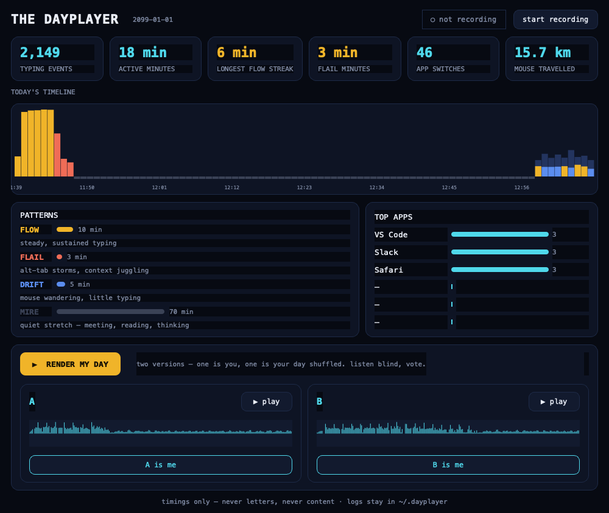

# Circadia

*formerly The Dayplayer, your workday is already a performance; Circadia plays it back.*

A small daemon records only the **timings** of your computer use, key-press
intervals, mouse distance, scroll velocity, window switches. **Never letters,
never content.** At the end of the day, press Render and the day condenses
into a ~3-minute piece:

- morning burst-typing → driving percussion
- the frustrated flail of alt-tabbing → skittering stutter blips
- the long silent afternoon stretch → one held, uneasy chord
- mouse movement → a soft wash swelling underneath

You hear the difference between a focused Saturday morning and a distracted
one, and it's yours.

## The app (macOS)

Double-click **`Circadia.app`**, a native menu bar app. You'll see **○**
appear in your menu bar.

1. Click the ○ → **Start Recording**. macOS asks once for *Input
   Monitoring*, allow it (System Settings → Privacy & Security). If events
   stay at 0 after allowing, quit the app from the menu and start it again.
2. Work normally. The ○ turns **●** while recording; the menu shows today's
   event count.
3. Tonight: click ● → **▶ Render My Day** (~30s). You get two players:
   **Play A** and **Play B**. One is your real day; the other is the same
   events with timings shuffled. Listen blind, then vote **A is me** /
   **B is me**, the reveal tells you if the structure is real.

If you moved the repo or changed code: run `./make_app.sh` to rebuild the app.

## Circadia Live, hear your state while you work

In the main window, press **◉ listen live**, the ring itself starts
breathing with your state, and a generative soundscape morphs in real time:

- **Flow** → a warm pad and a soft heartbeat that tracks your typing tempo
- **Flail** → static and two clashing notes creeping in
- **Drift** → an airy wind wash
- **Quiet** → a low tone, slowly breathing

**Calm mode** hides every number, just orb and sound. A non-judgmental
mirror: nothing to chase, nothing to feel bad about (see PRINCIPLES.md).

## The Week, the audible diary

Seven dots at the bottom of the window are your week (each colored by the
day's dominant pattern, click to visit a day). **Play My Week** turns
them into one album (~42s per day, crossfaded), a week of your life you
can *hear*. Tag your days ("shipped", "meeting day", "good day") in the
whisper line; once a tag has ≥2 days, the window tells you what your
tagged days look like versus the rest, descriptive, never scores.

## Download

**→ [Latest release](https://github.com/BenitoJD/the-dayplayer/releases/latest)**

| Your computer | File | After downloading |
|---|---|---|
| Windows | `Circadia.exe` | Double-click it. No install, no Python, no permission prompt. Lives in the system tray |
| macOS | `Circadia-macOS.zip` | Unzip, drag `Circadia.app` to Applications. First open: **right-click the app → Open** (it is not notarized yet, so double-click alone gets blocked) |

First minute on macOS: the app asks for **Accessibility** and **Input
Monitoring** (System Settings → Privacy & Security). It opens the right pane
for you and tells you what it can and cannot hear until you grant it. Without
the grant it records mouse movement only. Windows needs nothing.

Or build it yourself: `build_windows.bat` on Windows, `./make_app.sh` on
macOS, `build_macos.sh` for a standalone macOS bundle.

## The app (macOS, from source)

Either way: `Dayplayer.exe` lives in your **system tray** (near the clock).
Double-click the tray icon to start/stop recording, **no permission
prompt on Windows**, it just works. Right-click for the full menu
(Render, Play A/B, vote, Quit), same features as the macOS app.

## The window

From the menu bar / tray choose **◈ Open Dashboard**, one window, one
object: **your day as a living ring** (noon at top, a glowing dot at now;
quiet hours are negative space, active minutes paint the circle, hover
any point to see what happened). Under it, one sentence in plain human
words, *"You found 2h 41m of flow today. Your deepest run was 38
minutes, before lunch."*, and one button, **Play My Day**. Navigate days
with ‹ ›, tag the day in a whisper at the bottom.



## First run, and looking after your data

The first time you open it, Circadia shows one screen: what it records
(timings), what it never records (letters, titles, clipboard, screen), and
it asks for the macOS permissions with the reason attached. Nothing is
assumed on your behalf.

From the menu bar or tray you can also:

- **Start at login and record**: a reboot never silently records nothing.
  On macOS this writes a LaunchAgent, on Windows a registry Run entry, and
  both are removed the moment you untick it.
- **Delete All My Data...**: erases every recording, render and tag, after
  telling you exactly how much is there. Settings survive, your data does
  not.
- **Welcome & Setup...**: see the first-run screen again.

## The blind test is the gate

Continue if the real-timing render is distinguishable and you *want to hear
it again*. Revise the mapping if it's mush. Stop claiming success if only
the technical render works but hearing it tells you nothing.
See docs/PRINCIPLES.md.

## How it works

```
recorder.py    pynput hooks → ~/.dayplayer/logs/YYYY-MM-DD.jsonl
               (coarse classes only: key/space/tab/mod… + timestamps;
               macOS + Windows + Linux in one codebase)
features.py    per-minute vectors: key rate, rhythm CV, burstiness,
               flail rate, mouse distance, idle
composer.py    features → score (JSON): ticks, kicks, blips, drones…
synth.py       score → WAV (pure numpy synth, no DAW, no internet)
controller.py  shared brain: recorder + render + blind session + votes
app.py         macOS menu bar app (rumps), ● / ○ in the menu bar
wintray.py     Windows system tray app (pystray), same features
playback.py    afplay (mac) / winsound (win) / paplay (linux)
server.py      optional local dashboard (kept for the future share player)
```

Packaging: `make_app.sh` (mac dev bundle), `build_windows.bat` (exe),
and GitHub Actions builds `Dayplayer.exe` on every push.

The **score is JSON**, the same score can later be played in a browser
(Tone.js) or wrapped in a native Windows shell without touching the recorder.

Test the whole chain without recording anything:

```bash
.venv/bin/python tests/test_synthetic.py
```

## Testing

```
.venv/bin/python tests/test_edges.py          # weird days, corrupt files, extremes
.venv/bin/python tests/test_features.py       # launch at login, delete data, onboarding
.venv/bin/python tests/test_features_deep.py  # launchd really runs the job, delete guards
.venv/bin/python tests/test_synthetic.py      # pipeline: events -> features -> score -> WAV
.venv/bin/python tests/test_v2.py             # live states, audio callback, week, tags
.venv/bin/python tests/test_e2e.py            # REAL capture + live tail + render + blind
.venv/bin/python tests/test_ui.py             # drives the actual window (QtTest)
```

Every suite sandboxes itself: it sets `CIRCADIA_DATA_DIR` to a temp folder
before importing the app, so logs, renders, tags, the recorder's pid file and
even the launch-at-login plist live in that sandbox. A test can never touch
your real day, and `delete_all_data()` refuses outright to delete anything
outside its own data folder.

The deep suite also hands `launchd` a real job and checks it actually runs,
which is how we learned that an unescaped `&&` in the shell command made the
whole login plist invalid XML, silently killing launch at login.


Every suite isolates itself into a temp data dir, your real `~/.dayplayer`
is never touched by a test, and production code carries no test-only logic.

Edge cases covered: a 24-hour day (it used to render *silent*), a
one-minute day, a markers-only log, a corrupt or half-written JSONL line,
a 40k-event day (cached parses), two renders in the same second, votes
with no session, emoji/duplicate tags, a corrupt tags file, correlations
with one tagged day, and browsing to a day that never existed.

`test_e2e` reports capture honestly: mouse events usually flow immediately,
keyboard events need the one-time macOS Accessibility grant (see below). The
UI test clicks the real buttons: render → blind panel → wrong vote → right
vote → tag → live toggle → record toggle (which must spawn a *separate*
recorder process).

**Why the recorder is always its own process:** pynput's macOS keyboard
listener crashes inside any Cocoa/Qt app (its Carbon keyboard-layout query
collides with the GUI run loop, found with `faulthandler`). The apps spawn
`python -m dayplayer.recorder` and watch the log; one recorder feeds every
window, and closing a window never stops your recording.

## macOS permission (one time)

Real keyboard capture needs **System Settings → Privacy & Security →
Accessibility → add Circadia.app**, then restart the app. Without it the app
says so instead of pretending to record. Windows needs no permission.

## Privacy

See **[docs/TRUST.md](docs/TRUST.md)**, the short version: raw logs never
leave `~/.dayplayer`, only rendered audio is ever meant to be shared, and the
recorder is open for anyone to read.

## Roadmap

- **Stage 1 (now):** macOS menu bar app + blind test. Gate: is the
  real-timing render distinguishable from the shuffled one?
- **Stage 2:** signed & notarized .dmg, Windows shell, shareable render
  links (web player for audio only).
- **Stage 3:** mapping packs, week/month renders ("the audible diary"),
  named patterns (Flow, Flail, Drift, Mire).
